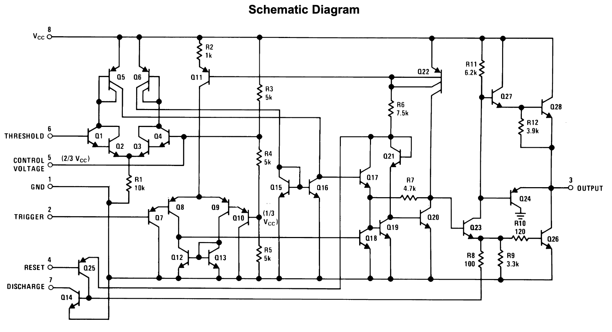
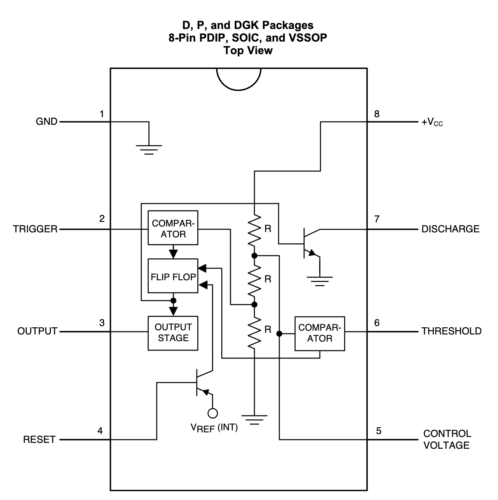
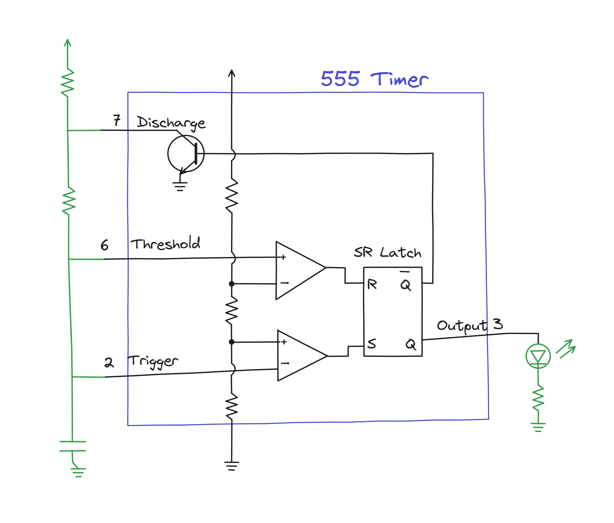
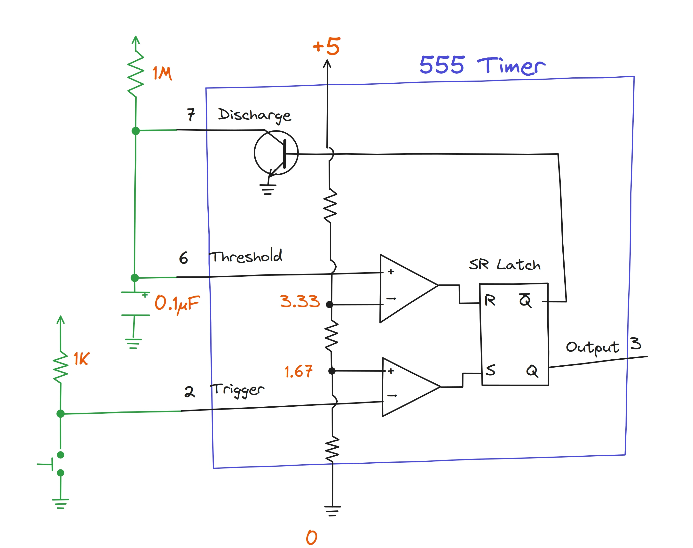
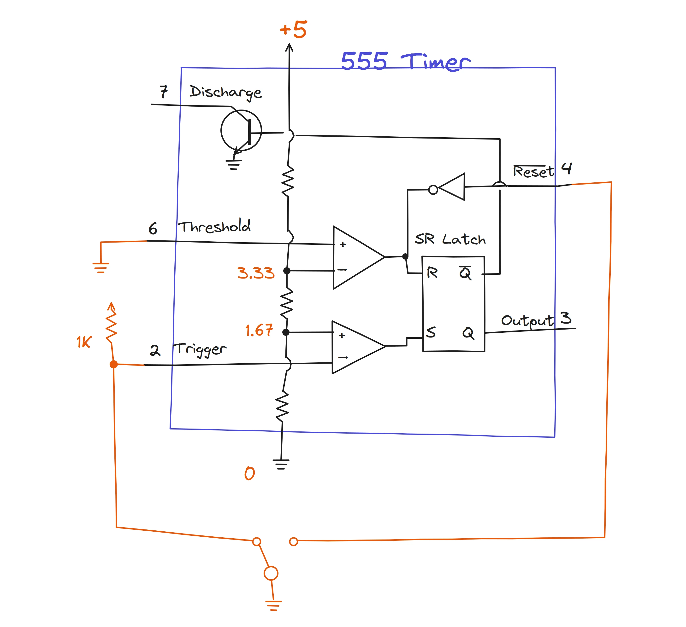
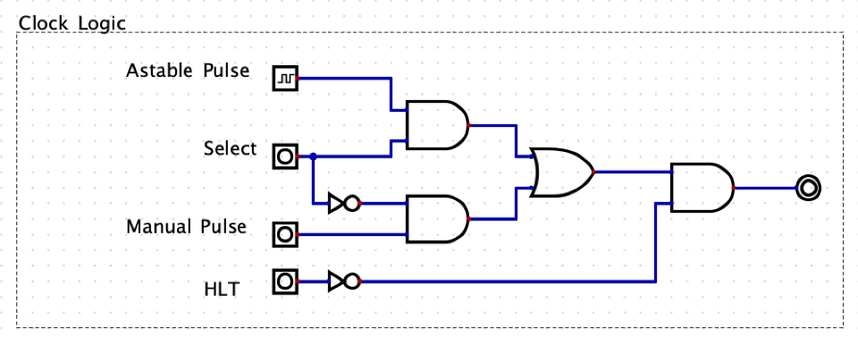

We will start with a high level overview and work our way down to individual parts and how it all fit together to create the clock signal. Let's start with the 555 timer.

Here is the [LM555 timer](https://www.ti.com/lit/ds/symlink/lm555.pdf?ts=1792755189087&ref_url=https%253A%252F%252Fwww.ti.com%252Fproduct%252FLM555) datasheet.

The schematic could overwhelm us at first. I found an excellent resource to brush up my electronics fundamental knowledge. I would recommend skimming the Chapter 3 - Semiconductors from [All About Circuits](https://www.allaboutcircuits.com/textbook/) online textbook. What a great resource - it sums up all my 4 years of Electrical Engineering degree.

Let's condense it and look at the pin configuration.

## 1. Components
### i. S-R latch
S-R latch has set and reset pins, when SET is high, the output is Q and when RESET is high, the complement of Q is high.

### ii. Comparator

A comparator has two inputs and one output. It asks one question: is the `+` input higher than the `-` input?
* higher than `−` → output goes HIGH
* lower than `−` → output goes LOW

## 2. Ben Eater's circuit

Ben Eater has simplified the circuit even better in his 8-bit video series.

| Mode | Stable states | Output behavior | Use |
|---|---|---|---|
| **Astable** | 0 | Flips back and forth forever | Clock generator |
| **Monostable** | 1 | Rests low, makes one pulse when triggered, then returns | One-shot pulse, delay, debounce |
| **Bistable** | 2 | Stays high or low until pushed to the other | Switch / memory (an SR latch) |

[i. Astable 555 timer video](https://www.youtube.com/watch?v=kRlSFm519Bo&list=PLowKtXNTBypGqImE405J2565dvjafglHU&index=2)

[ii. Monostable 555 timer video](https://www.youtube.com/watch?v=81BgFhm2vz8)

[iii. Bistable 555 timer video](https://www.youtube.com/watch?v=WCwJNnx36Rk)

[iv. Clock Logic](https://www.youtube.com/watch?v=SmQ5K7UQPMM)

Here, I combined the clock logic for all three states in `Digial`. When `Select` is high, we get the `Astable` output, low value will allow us to select `Monostable` aka manual pulse. `HLT` allows us to halt the clock signal.

