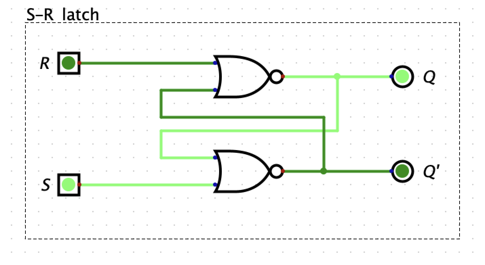
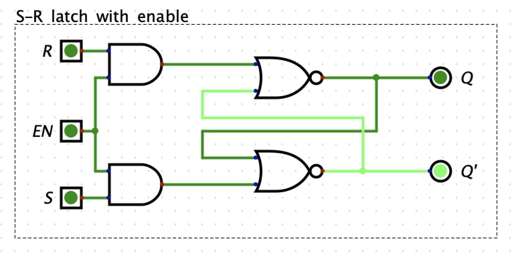
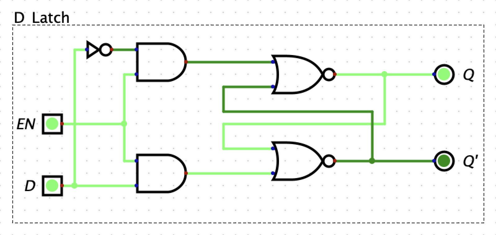
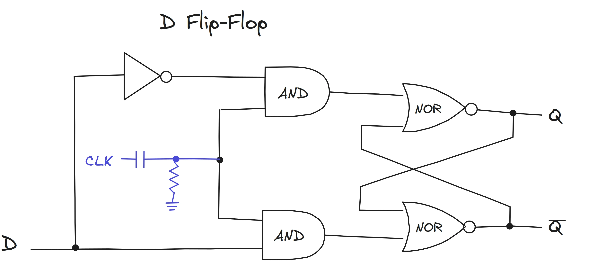
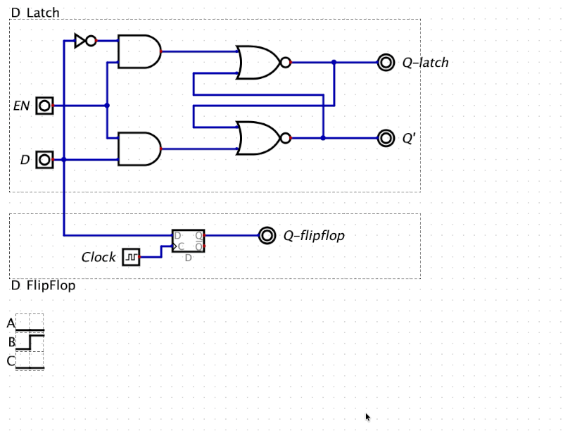

A latch is a sequential asynchronous circuit. Sequential means - whose output depends on the current inputs and the past (stored state), not just the inputs. And asynchronous means doesn't depend on the clock.

Here is the diffrence:

```shell
Combinational: Output = f(Inputs)
  Examples: adder, selector, XOR. Same inputs always give the same output.

Sequential: Output = f(Inputs, Stored state)
  Examples: latch, flip-flop, register, counter. Same inputs can give different outputs.
  ```
## [1. S-R latch](https://www.youtube.com/watch?v=KM0DdEaY5sY&list=PLowKtXNTBypGqImE405J2565dvjafglHU&index=6)

S-R latch has set and reset pins, when SET is high, the output is Q and when RESET is high, the complement of Q is high.




## [2. D latch](https://www.youtube.com/watch?v=peCh_859q7Q)
If we invert the reset pin of S-R latch with enable, we get the D latch.



## [3. D flip-flop](https://www.youtube.com/watch?v=YW-_GkUguMM&list=PLowKtXNTBypGqImE405J2565dvjafglHU&index=8)

A D latch is level-triggered (it follows D the whole time the enable is active). A D flip-flop is edge-triggered (it samples D only at the instant the clock changes).




Here is the timing diagram of D latch vs D Flipflop in `Digital`



