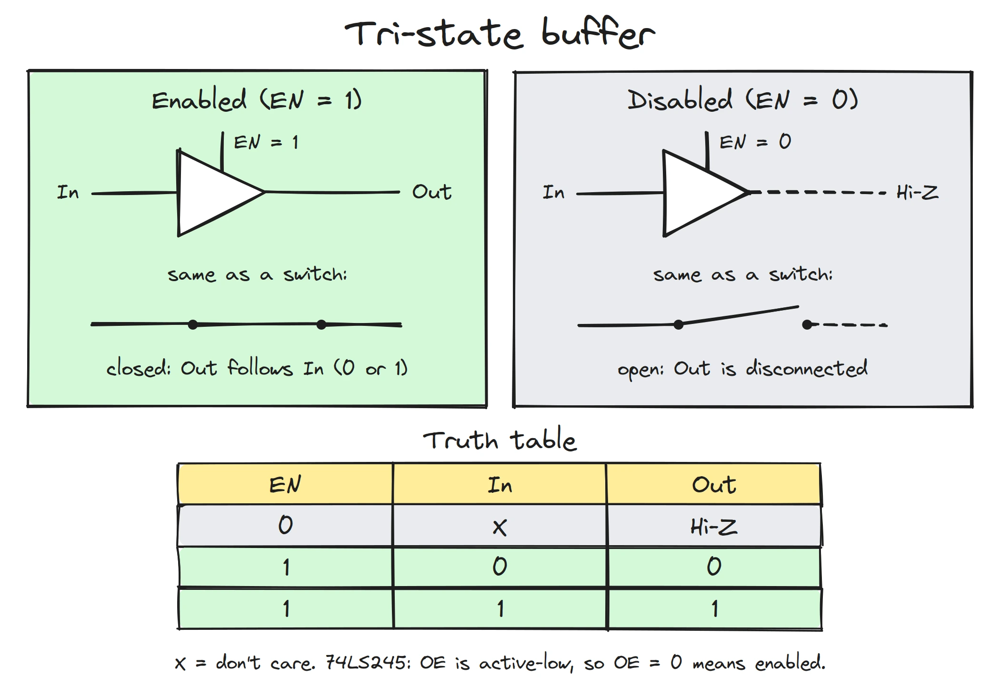
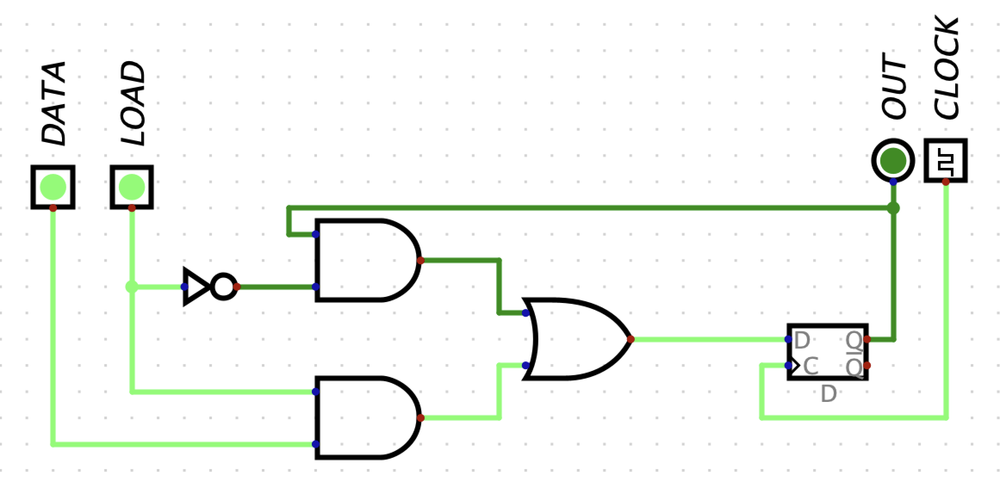
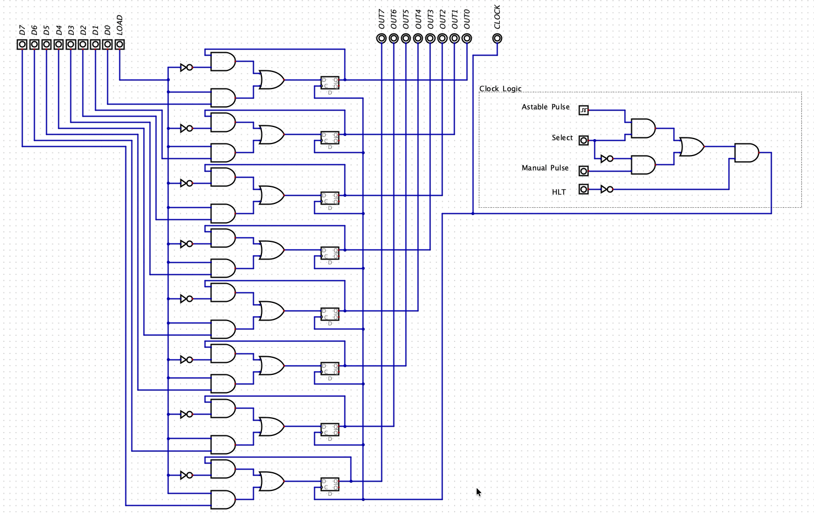
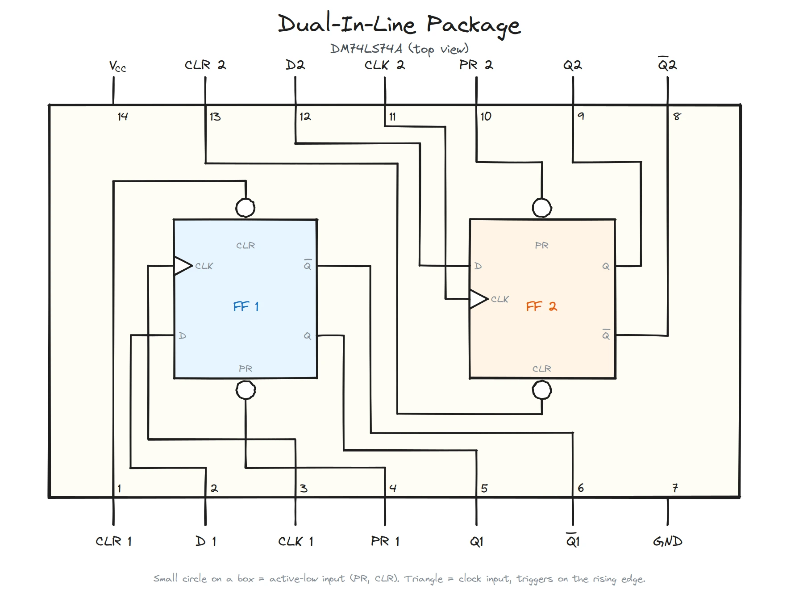
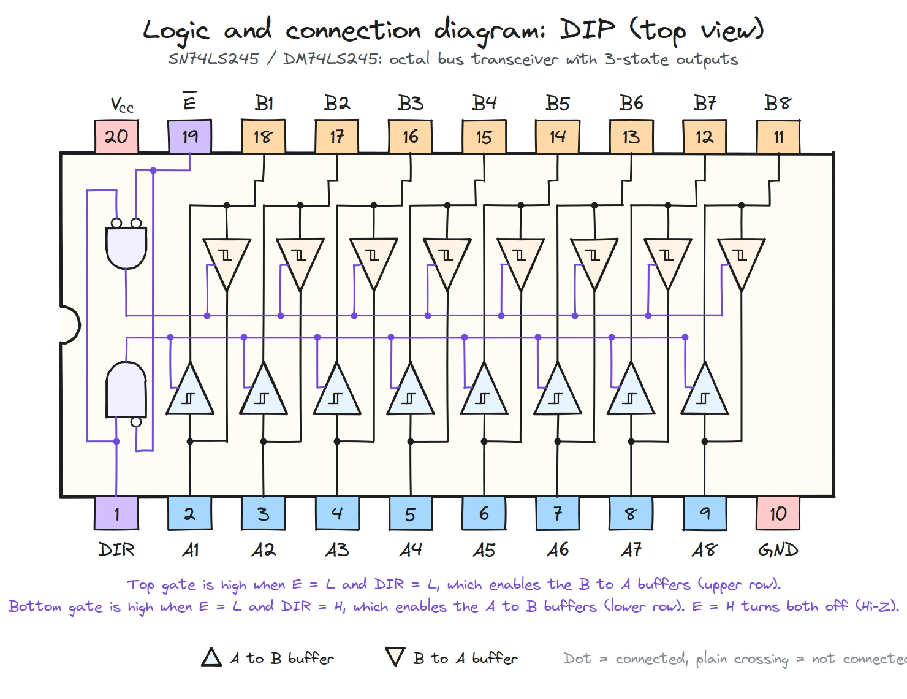

## [1. Tri-State Buffer](https://youtu.be/faAjse109Q8?si=GxSNrjkaNE9UZHme)
A bus connects several registers, such as the ALU register, the address register, and the RAM register. But only one of them can put its value on the bus at a time.

So far, we’ve treated the output of a latch or flip-flop as either high or low, 1 or 0. That works for digital logic, but what does it mean electrically? Inside a logic gate, transistors steer current in one of two directions. This is where the terms source and sink come in:

* `Source`: current flows out of the output pin into the load. The chip is supplying current.
* `Sink`: current flows into the output pin and through the chip to ground. The chip is absorbing current.

A high output means the pin is sourcing, and a low output means the pin is sinking. That is the key to the bus problem. You might think the other registers can simply output 0 while one register drives the bus. But a low output is not “off”. It actively pulls the line to ground. If one register drives the bus high while another drives it low, one is sourcing current while the other sinks it, and the two fight each other.

A tri-state buffer solves this by adding a third output state: high impedance (Hi-Z), where the output is electrically disconnected from the bus. Each register connects through a tri-state buffer, and only the selected register’s buffer is enabled. All the others sit in Hi-Z and stay out of the way.

Here is the datasheet of [SN54 / 74LS24](https://www.amigawiki.org/lib/exe/fetch.php?media=de:parts:74ls245_motorola_datasheet.pdf) octal bus transreciever that Ben Eater explains in his [Tri-state Logic video](https://youtu.be/faAjse109Q8?si=GxSNrjkaNE9UZHme).

## [2. Designing and building 1-bit register](https://youtu.be/-arYx_oVIj8?si=bSJsu6Qh4PgKhjuh)

Here is the basics of 1-bit register.

 
And I ended up building an 8-bit register as well. Its the same 1-bit circuit repeated 8 times. For the clock signal, I am using the clock logic we designed in [Part-1-Clock](part-1-clock.md) topic.

In Ben's video, he used [DM74LS74A - Dual Postive Edge Trigerred D Flip Flops](https://rocelec.widen.net/view/pdf/terhnuy8f0/RE_DSHEET_DM74LS74AM-ROC.pdf?t.download=true&u=h6ohhb) for his breadboard circuit. If you are interested in it, here is the connection diagram.

Also, to prevent multiple register writing data to data bus at once, he is using [ SN54 / 74LS245 Tri-state Buffer](https://www.amigawiki.org/lib/exe/fetch.php?media=de:parts:74ls245_motorola_datasheet.pdf). Value of `PIN 1 DIR` determines the direction of buffer from A to B or B to A.

Since building an 8-bit register can get quite complicated on a breadboard, later he replaces the above two dual D-Flipflop IC and Tri-state Buffer IC with [SN74LS173A 4-BIT D-TYPE REGISTERS
WITH 3-STATE OUTPUTS](https://www.ti.com/lit/ds/symlink/sn74ls173a.pdf?ts=1794362826448)

## [3. Building an 8-bit register](https://www.youtube.com/watch?v=CiMaWbz_6E8&list=PLowKtXNTBypGqImE405J2565dvjafglHU&index=12)

Here I will try to build the 8-bit register using the combination of  two SN74LS173A (4 bit D-Type FlipFlop) and one 74LS245(Tri-State Buffer) as described by Ben in his video.

